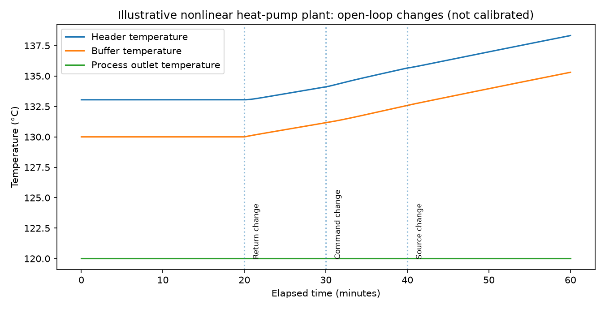

# HTHP-ControlBench

**Research software for the comparative study of PI/PID, model-predictive and self-optimising control of industrial high-temperature heat pumps.**


> **Verification correction (audit A01, 2026-11-03):** The WP3 relay
> amplitude estimator has been corrected to use settled oscillation peaks,
> rather than the relay switching thresholds. Historic committed WP3–WP5
> controller comparisons were generated with the *previous* relay tune;
> the root-level files remain **legacy results**. The corrected, CI-replayed
> [L1_RelayPeak_v2 benchmark](results/L1_RelayPeak_v2/manifest.json) is now
> published separately (100 WP4 runs, 0 numerical failures, relay Kp ≈ 0.20117).
> Only that versioned matrix supports corrected L1 comparisons; it is still
> **synthetic**, not an equipment or real-fluid-control benchmark. See
> [the A01 methods note](docs/AUDIT_A01_RELAY_CORRECTION.md).

**Current implementation: WP2 synthetic plant + WP3 independently tuned PI and robustness + WP4 constrained MPC and OSQP audit + WP5 scenario-wise comparative synthesis + WP6 synthetic SOC/active-set screening + WP7 real-fluid property-cycle screening (uncalibrated).** Two independent tuning methods, anti-windup, and reproducible noise, delay, parameter-mismatch and actuator-saturation comparisons are implemented. Physical PID tuning and real-fluid **equipment calibration** are **not** implemented or validated. WP6 implements **exploratory nonlinear steady-state SOC candidate evaluation** using an explicitly hypothetical second hot-loop circulation actuator, plus a limited dynamic/noisy pilot; it is not a validated industrial SOC structure or a proof of nonlinear dynamic SOC optimality. WP4/WP5/WP6 conclusions are simulation-only.



> **Scientific status:** This is an illustrative computational research model. All operating-point parameters and performance values are synthetic. Do not use it to design, operate or certify real heat-pump equipment.

The [research plan v0.5](docs/RESEARCH_PLAN_v0.5.md) is the frozen proposal; it contains intended work packages, not a claim that those components are already built. The [independent WP2 review brief](docs/INDEPENDENT_CODE_REVIEW_BRIEF.md) describes planned verification.

## Research organisation

The planned programme shares one plant model across three independently testable research studies: (I) PI/PID versus MPC; (II) self-optimising control with active-set economics; (III) fluid feasibility and thermal-storage flexibility. Study I includes the synthetic WP5 comparative analysis. Study II now includes a provisional WP6 nonlinear SOC candidate study and a negative degree-of-freedom result for the one-actuator baseline; comprehensive nonlinear/dynamic/noisy-plant SOC validation remains open. Study III (real-fluid/storage) remains a research stage. Their inclusion in the plan does not imply completed calculations.

---

## WP2 model (implemented)


**Status:** executable research prototype; *not* a calibrated heat pump, digital twin, plant controller, or claim of equipment feasibility. **Planning baseline:** `HTHP_ControlBench_Master_Research_and_Implementation_Plan_v0.5.md` (not edited by this deliverable). Independent review: `HTHP_ControlBench_Independent_Review_v0.5.md`.

## What is implemented

- Three-state nonlinear, lumped ODE `x=[T_header(K), T_buffer(K), n_actual]`, applied command `u=n_cmd`, first-order compressor lag, 60-second controller updates, per-update slew limit.
- Separate physical header/buffer energy balances in J/K, W and s, with temperature-dependent ambient losses. `Q_hp(n,T_source,T_header)` is a **declared synthetic derating map** (not calibrated to a compressor); `P_el=Q_hp/(eta_II*COP_Carnot,refrigerant)` uses finite hot/cold approaches and is only a thermodynamic sanity approximation.
- General counterflow HX with two finite stream capacity rates; stable effectiveness calculation based on `expm1` even for `Cr -> 1`. Unit tests cross-check high-precision Decimal evaluation.
- Process-side bypass solved by bisection **algebraically at each ODE evaluation**, not as an independent compressor controller state or manipulated variable; alternate no-bypass passive case.
- Provisional `UA(f)=UA_nominal * f^a`, with `a=0,0.6,0.7,0.8` sensitivity. This is an exploratory correlation *not validated against any HX geometry or operating regime*.
- Separate actual physical heat, quality-qualified heat and unmet service. Any actual physical heat transfer remains inside conservation law even if below specification.
- RK4 integration of temperature/modulation **and physical energy integrals**; independent endpoint-trapezoid energy audit and timestepping tests.
- A pre-programmed **WP2 open-loop** disturbance experiment. WP3 supplies synthetic closed-loop PI tests; WP4 implements synthetic constrained MPC, including an active-set-crossing predictor/fallback test. WP6 adds exploratory nonlinear **steady-state SOC candidate screening** in a *separate, explicitly extended two-actuator model*. No derivative/PID hardware tuning or validated industrial SOC implementation is claimed.

## Execute

Requires Python 3.10+ and `numpy`; `matplotlib` is optional and used only for plotting. From this folder:

```bash
PYTHONPATH=. python -m unittest discover -s tests -v
PYTHONPATH=. python -m ht_hp_controlbench
PYTHONPATH=. python scripts/make_report.py
PYTHONPATH=. python scripts/run_wp3.py
PYTHONPATH=. python scripts/run_wp3_robustness.py
```

Outputs: `results/wp2_illustrative_timeseries.csv`, `results/ua_sensitivity.csv`, `results/wp2_illustrative_thermal_response.png`, `results/verification.txt`.

## WP3 simulation-only PI baseline (implemented)

[Read the WP3 methods, tuning and limitations](docs/WP3_PI_CONTROL.md). WP3 implements bounded PI with anti-windup and bumpless initialization on the unchanged WP2 plant; it estimates gains independently from a simulated FOPDT step response and relay oscillation, with three IMC lambda settings and a relay-derived PI. The corrected four-hour comparison and transfer to bypass-controlled operation are in [the versioned WP3 table](results/L1_RelayPeak_v2/wp3_pi_comparison.csv) and [identification report](results/L1_RelayPeak_v2/wp3_identification.txt). Root-level equivalents are legacy v1. This is **not** experimental PI/PID tuning or validated control of heat-pump hardware.

**WP3 robustness extension:** [Methods and limitations](docs/WP3_ROBUSTNESS.md) · [corrected 80-run matrix](results/L1_RelayPeak_v2/wp3_robustness_matrix.csv) · [machine-readable summary](results/L1_RelayPeak_v2/wp3_robustness_summary.json). Four tuning variants were compared across 20 predeclared synthetic scenarios covering paired sensor noise, 60/180-s measurement delays, ±20% plant perturbations, combined uncertainties, severe capacity saturation, temporary setpoint-excursion recovery, and transfer to bypass mode. In the corrected v2 synthetic suite the relay-derived PI had lower tracking IAE in 19/20 scenarios, but was more sensitive to delayed/noisy measurements and produced substantially greater command movement. This is **not** an equipment performance or controller robustness certification.

**Caution:** The WP2 example simulates scripted changes at 20 min (process return), 30 min (open-loop compressor command), and 40 min (source temperature). It does not establish tracking, stability under a real controller, or comparative controller performance.

## Nominal physics and differences from WP1

The plan's synthetic duty-limiter equilibrium remains `T_buffer=130°C`, `T_header=133.05°C`, `Q_hp=310 kW`, actual modulation `n=0.75`. With `no_bypass`, physically transferred heat at the same buffer temperature is `312.636114 kW`; **the dynamic temperature-dependent header heat loss makes steady Q_hp = 322.641703 kW, not the earlier constant-5-kW worksheet's 322.636114 kW**. This ~5.59 W difference is a consequence of moving from a fixed-loss worksheet to a state-dependent loss law. Tests explicitly expect the physically self-consistent dynamic equilibrium, rather than concealing the discrepancy.

With buffer fixed at 130°C and service duty held at 300 kW, the UA exponent affects the necessary valve through-flow fraction but **not the header temperature or heat-pump duty** (because the required thermal duty, fixed losses, and chosen buffer state have not changed). This does **not** mean UA uncertainty is dynamically irrelevant: it affects actuator margins and whether the local valve saturates.

## Verification boundary

The original 13 WP2 executable tests check the nominated synthetic algebra, high-precision HX stability, equilibria for both modes, flow degrees of freedom, physical service classification, the bypass active-set kink, command/actual lag, slew, analytic heat-loss-only decay, timestep convergence, energy integrals and an independently computed trapezoidal energy audit. Tests do **not** establish measured plant fidelity or temperature/pressure/refrigerant validity. All equipment parameters are assumed, not specifications; WP7 provides a separate real-fluid research model.

## Project organization

- `ht_hp_controlbench/core.py`: model, finite-flow HX, synthetic cycle, algebraic bypass, RHS and equilibrium solver
- `ht_hp_controlbench/sim.py`: bounded command schedule including optional closed-loop feedback, RK4 and energy integrals
- `ht_hp_controlbench/pi.py`: PI controller, FOPDT and relay identification, gain calculations and metrics
- `scripts/run_wp3.py`: reproducible PI tuning sweep, numerical results and plot
- `tests/test_wp3.py`: independent tuning/feedback tests
- `ht_hp_controlbench/robustness.py`: isolated observation-noise/delay layer, scenario parameters and comparison metrics
- `scripts/run_wp3_robustness.py`: predefined 20-scenario/4-controller deterministic sweep and reports
- `tests/test_wp3_robustness.py`: sensing, uncertainty, constraints, recovery, paired-seed and energy-accounting tests
- `tests/test_wp2.py`: independent numerical/physics assertions
- `scripts/make_report.py`: reproducible UA study, figure and verification summary
- `reference/WP1_Feasibility_v0.5.py`: frozen earlier standalone worksheet for provenance
- `results/`: generated synthetic results

## Next scientific tasks, not delivered here

1. Confirm a complete WP2 operating-envelope test matrix beyond the single nominal point; consider numeric stiffness and adaptive solver cross-check.
2. Define sensor/measurement noise in a separate observation layer (not injected into conservation equations).
3. WP3 follow-up: evaluate wider uncertainty distributions, noise correlation, actuator wear models and formal robustness margins; the initial 20-scenario simulation screening is implemented.
4. WP4 now includes the LTV/QP baseline, explicit trust region, nonlinear rollout check, PI fallback, and a mid-horizon bypass active-set crossing test. Extend the MPC comparison to noisy/delayed measurements, broader uncertainty envelopes and solvers before declaring the control study complete.
5. WP7 property and coupled-thermodynamic research is implemented separately; OEM compressor-map calibration and measured equipment validation remain external requirements.

## Licence and citation

Code is published under the MIT License; see [LICENSE](LICENSE). Citation metadata, including the author’s verified ORCID, is in [CITATION.cff](CITATION.cff). No paper, published journal result or experimental validation is implied.

## WP4 locally linearized constrained MPC (initial prototype)

[Read the MPC methods, fairness protocol, results and limits](docs/WP4_MPC.md). WP4 constructs a new locally linearized plant and affine **joint electrical-power** model every 120 seconds, solves a convex-QP-structured constrained receding-horizon problem with SciPy SLSQP, checks the solution against a nonlinear model rollout, and retries/returns to bounded PI when a model or solver check fails. This is **not** a certified MPC safety controller.

Reproduce with `python scripts/run_wp4.py` after installing dependencies. The existing [full study CSV](results/wp4_control_comparison.csv), [JSON summary](results/wp4_control_summary.json) and [plot](results/wp4_control_comparison.png) remain legacy v1; the source script now identifies the corrected relay gain dynamically, but these short-study artifacts must be separately regenerated. The fair persistence case and the artificially perfect future-forecast case are labelled separately. PI can outperform MPC under model mismatch; no real-world heat-pump advantage has been established.

## WP4 robustness + solver audit (new extension)

[WP4 robustness and QP audit methods](docs/WP4_ROBUSTNESS_AND_QP_AUDIT.md) · [corrected 20-case/5-method matrix](results/L1_RelayPeak_v2/wp4_robustness_matrix.csv) · [summary](results/L1_RelayPeak_v2/wp4_robustness_summary.json) · [figure](results/L1_RelayPeak_v2/wp4_robustness_comparison.png).
The robustness comparison now runs all PI and MPC methods with one identical noisy/delayed buffer-temperature sensor, an identical 120-second controller update period, a nominal-model-based estimate for MPC's unmeasured states, and independently reported perfect-forecast scenarios. On the synthetic predeclared set, MPC has lower IAE in 14 of 20 cases; relay-derived PI leads the other six. Severe physical compressor derating causes service failure under every controller. **No experiment or robust-stability proof is implied.**

A dedicated **optional OSQP QP backend** was added alongside SciPy SLSQP. Install `pip install -e '.[plots,qp]'` and run `python scripts/run_wp4_solver_audit.py`; GitHub Actions executes both solver checks and the full robustness matrix. Backend equivalence is a numerical check, not a hardware/real-time guarantee.


## WP5 — service-gated PI/MPC comparative analysis (implemented)

[WP5 research methods and limitations](docs/WP5_COMPARATIVE_STUDY.md) · [corrected full comparative report](results/L1_RelayPeak_v2/wp5_comparative_report.md) · [paired comparison CSV](results/L1_RelayPeak_v2/wp5_paired_comparisons.csv) · [case-level quality screening](results/L1_RelayPeak_v2/wp5_case_comparison.csv) · [synthetic IAE contrasts](results/L1_RelayPeak_v2/wp5_paired_tracking.png) · [energy contrasts only for service-compliant pairs](results/L1_RelayPeak_v2/wp5_eligible_energy.png).

WP5 uses **the existing** WP4 twenty-case/five-method numerical matrix; no new plant calibration or controller tuning is introduced. All **100 runs** were numerically complete, but both 20%-lower-process-UA and severe 40%-compressor-derating cases failed specification-qualified service for every controller. In the raw unconditional IAE ranking, MPC leads **14/20** scenarios and relay PI **6/20**. When both simulated process service and physical heat transfer are required, **MPC leads 13 of the 18 scenarios with any qualified method**, relay PI 5. This is a count over deliberately selected, correlated synthetic cases—not a statistical probability or demonstration of industrial performance.

The report includes 80 paired MPC–PI comparisons, quality-gated energy and Pareto analysis, two separately marked perfect-future-disturbance cases, documented fallback failures, and an optional platform-specific end-to-end runtime pilot. It does **not** establish energy-cost savings, model predictive control stability, or a calibrated commercial HTHP operating envelope. Run `python scripts/run_wp5.py` after `python scripts/run_wp4_robustness.py` to regenerate every WP5 table and figure.

---

## WP6: active-set self-optimising control investigation (implemented, synthetic)

The unchanged baseline WP2 thermal plant has one manipulated compressor command; the minimum process-service requirement eliminates its only steady economic degree of freedom in the qualifying optimum. **No nontrivial SOC candidate is justified for that baseline under these constraints.**

The *separate exploratory pump-actuated extension* adds a hypothetical hot-side circulation flow ratio `r`, a first-order pump flow lag for dynamic tests, an explicit cubic synthetic pump power law and flow-dependent heat exchanger UA. Its nonlinear steady economic optimisation identifies a pump-upper-constraint region and a remaining interior flow degree of freedom. WP6 constructs constant controlled-variable candidates within these regions (including a Hessian-based first-order stationarity combination), freezes them before a separate held-out disturbance grid, and reports **J_SOC − J_opt** only when heat service is equally feasible.

**Source and scope:** [WP6 standalone scientific report](results/wp6_scientific_report.md) · [Methods and limitations](docs/WP6_SOC_ACTIVE_SET.md) · [Results JSON](results/wp6_summary.json). Candidate CVs are not identical to Manum–Skogestad's steady-state/quadratic nullspace method. The dynamic/noisy-plant pilot is a separate exploratory extension, not proof that a controller self-optimises on actual equipment. Storage/tariff arbitration and measured compressor calibration remain undone; WP7 now provides an uncalibrated CoolProp steady-state property anchor without changing WP6 numerical results.

Reproduce from the repository root:

```bash
python scripts/run_wp6.py
python -m unittest discover -s tests -v
```

The WP6 script writes an explicit training/held-out active-set ledger, the 27-row nominal loss table, 162 additional parameter-mismatch tests, matched dynamic-service runs, a JSON provenance/audit file, a technical report and two figures. **No earlier WP2–WP5 result is altered.**


---

## WP7: real-fluid property and pressure screen (first implementation; not hardware validated)

[WP7 thermodynamic assumptions, tests and limitations](docs/WP7_REALFLUID.md). A new **separate** CoolProp HEOS four-point subcritical cycle evaluates fluid phase limits, evaporating/condensing saturation pressure, compressor discharge, enthalpy-defined COP and modelled mass flow at an **imposed synthetic 310 kW duty**. IF97 water is used for saturation pressure and hypothetical water enthalpy storage; the water HEOS backend provides a cross-backend check.

No WP2–WP6 controller results are silently modified. The reference offdesign map uses an assumed equivalent suction volume-flow relation, not equipment manufacturer displacement, and rejects out-of-range states instead of extrapolating. Real-device compressor efficiency, discharge/pressure limits, working-fluid safety, A separate TESPy network-equation cross-check is now included on Python >=3.11, but independently sourced property data, calibrated offdesign compressor maps and measured validation remain outstanding.

To run with actual property values:

```bash
python -m pip install -e '.[plots,qp,realfluid]'
python scripts/run_wp7.py
```

GitHub Actions executes the property model and uploads generated `results/wp7_*` CSV, JSON, Markdown and plot as a downloadable workflow artifact (Python 3.12 job). Missing CoolProp is a hard error in the numeric runner, never replaced with fabricated outputs.

For the separately reproduced TESPy network checks on Python >=3.11: `pip install -e ".[tespy,realfluid]"` and run `python scripts/run_wp7_tespy.py`. TESPy shares CoolProp EOS and this does not validate manufacturer hardware.


## WP7 numerical thermodynamic closeout (property-backed, NOT OEM-calibrated)

WP7 now includes an explicit **system-level** assessment, rather than interpreting a refrigerant EOS point as evidence of a complete heat pump. [Methods and acceptance boundaries](docs/WP7_RESEARCH_CLOSEOUT.md) · [property and phase screen](docs/WP7_REALFLUID.md). Separate `ht_hp_controlbench/thermo_feasibility.py` couples actual WP2 finite-process-HX service to CoolProp condenser power, rejects compressor rates outside the bounded fluid map and screens water phase using IF97 at an *assumed* 6 bar absolute. The optimistic 5000 kg buffer charge calculation integrates real-water enthalpy; published output is explicitly conditional on the completely hypothetical compressor displacement/efficiency and unknown hardware limits.

`ht_hp_controlbench/tespy_offdesign.py` executes TESPy **design then offdesign**, with a fully declared **artificial** compressor-efficiency characteristic. The network uses the *same CoolProp EOS*; it checks equation implementation, not independent fluid data or a manufacturer's compressor map. `ht_hp_controlbench/fluid_dynamics.py` integrates buffer-water enthalpy and a property-derived compressor heat/power map, with the original WP3 PI gains frozen for a small sensitivity experiment. WP2–WP6 sources and previously published controller rankings are not retroactively changed.

With CoolProp and TESPy installed: `python -m pip install -e '.[plots,qp,realfluid,tespy]'`, followed by `python scripts/run_wp7.py`, `python scripts/run_wp7_tespy.py`, `python scripts/run_wp7_completion.py` and the full test suite. CI publishes `results/wp7_completion_report.md`, the machine-readable `results/wp7_completion_summary.json`, the process/charge ledger, fluid-PI pilot and TESPy design/offdesign comparison. These deliver **numerical research closure under assumptions**, NOT proof of a commercially feasible 310 kW / 135°C machine. OEM displacement, pressure and discharge ratings, compressor efficiency curves, lubricant compatibility, hydraulic/pressure certification and experimental tests remain unverified.

## WP7 controller-transfer experiments — synthetic predictor vs property predictor

The original [WP7 v1 matched property-truth controller pilot](results/wp7_control_pilot_report.md)
keeps the original **WP2 synthetic MPC predictor**. The separate
[WP7 v2 property-consistent prediction study](results/wp7_property_predictor_v2_report.md)
injects IF97 buffer-enthalpy dynamics and the CoolProp Q/P map into the
same local-QP MPC solver, and uses a property-model observer corrected only
by the shared noisy/delayed buffer sensor. Its [exact reproduction protocol](docs/WP7_PROPERTY_PREDICTOR_V2.md)
freezes the v1 run ledger and reproduces **all ten PI trajectories** before
comparing the five new MPC runs. The earlier data are **not overwritten**.

The v2 results complete all 15 runs and qualify service in all 10 PI–MPC
pairs, but only **5/10** satisfy the stronger final thermal-inventory and
actuator-equivalence gate. Replacing the synthetic predictor lowers MPC
tracking IAE in **2/5** scenarios and increases it in **3/5**; there are
zero solver fallbacks. In every electricity-comparable case, MPC electricity
use is **higher** than the matched PI comparator, by **0.16–0.78 kWh**
over two hours. No cost-saving or general superiority claim is supported.
These are model-to-model numerical results only, **not independent OEM or
instrumented controller validation**. Reproduce with
`python scripts/run_wp7_property_predictor.py` after installing
`.[qp,realfluid,plots]`.

## WP7 independent experimental evidence and physical validation gate

[Independent empirical-data protocol](docs/WP7_INDEPENDENT_EMPIRICAL_EVIDENCE.md) ·
[checksum-verified evidence and nonvalidation report](results/wp7_external_empirical_evidence_v1.md) ·
[provenance ledger (JSON)](results/wp7_external_empirical_evidence_v1.json).

The WP7 external-evidence audit checks public R1233zd(E) compressor
measurements using raw-file checksums and *separates genuine measurements
from EN12900-generated manufacturer-polynomial rows*. The
[Widmaier et al. experimental/computational dataset](https://doi.org/10.5281/zenodo.17599603)
has 32,073 records: 31,702 generated, 371 experimental and only 22
experimental pure-R1233zd(E). The
[Leclercq two-phase R1233zd(E) scroll dataset](https://doi.org/10.5281/zenodo.20445833)
contains 67 measured records but has a different oil/wet-inlet operating
domain. **Neither validates the assumed 310 kW compressor or 133°C system**.
A [more directly relevant 37 kW experimental HTHP dataset](https://doi.org/10.17632/56m3dd55zf.1)
is identified, but has not been ingested for numerical comparison.
The public [BITZER CSH2T family information](https://www.bitzer.de/mv/en/products/screw-compressors/csh2t/)
states useful output temperatures up to 120°C, not proof of the 133°C
reference machine.

The audit explicitly reports **missing OEM and measured finite-source/sink
feasibility** and **no independent instrumented observer-validation dataset**;
it rejects claims based on a different rig, generated performance rows,
model-derived displacement or internally consistent simulation. It
computes only conditional necessary source-flow arithmetic, not
HX/pump/pressure-equipment approval. Reproduce with
`python scripts/run_wp7_external_empirical_audit.py` after installing
`.[realfluid]`. The original experimental files are not committed to
the repository; hashes, DOIs and aggregated evidence are preserved.

A separate [seven-channel real-instrumentation contract](docs/WP7_INSTRUMENTED_OBSERVER_DATA_CONTRACT.md)
and `scripts/score_wp7_measured_observer.py` can score held-out header/
modulation errors **only after a genuine matching-asset CSV and its
cryptographic provenance manifest are provided**. The tool cannot create
instrument readings or certify OEM performance. Both source and sink
finite-flow gates currently return **UNVERIFIED**; water-based
temperature-drop/flow calculations are arithmetic sensitivities only.

## WP8 — Temperature-qualified storage and synthetic price flexibility

WP8 tests finite high-temperature water storage against the WP7 CoolProp/IF97
cycle and WP2 finite-flow process heat exchanger. The same frozen WP3 PI gains
run a **fixed-buffer comparator** and a **clearly labelled tariff-scheduled
setpoint heuristic** under an identical 24-hour nonlinear plant and synthetic
EUR/kWh schedule. Costs are credited **only** when both cases finish, satisfy
all process samples, obey the declared operating envelope, and end within
0.5 kWh of the same stored enthalpy. The hypothetical 24 bar(a) and 145°C
compressor limits are *not* manufacturer ratings. There is **no OEM-verified
storage capacity or actual electricity-market saving**.

`python scripts/run_wp8.py --full` regenerates the complete WP8 scenario
matrix, plots and scientific report when CoolProp is installed.
See [WP8 methods](docs/WP8_STORAGE_FLEXIBILITY.md) and
[WP8 generated report](results/wp8_scientific_report.md).

