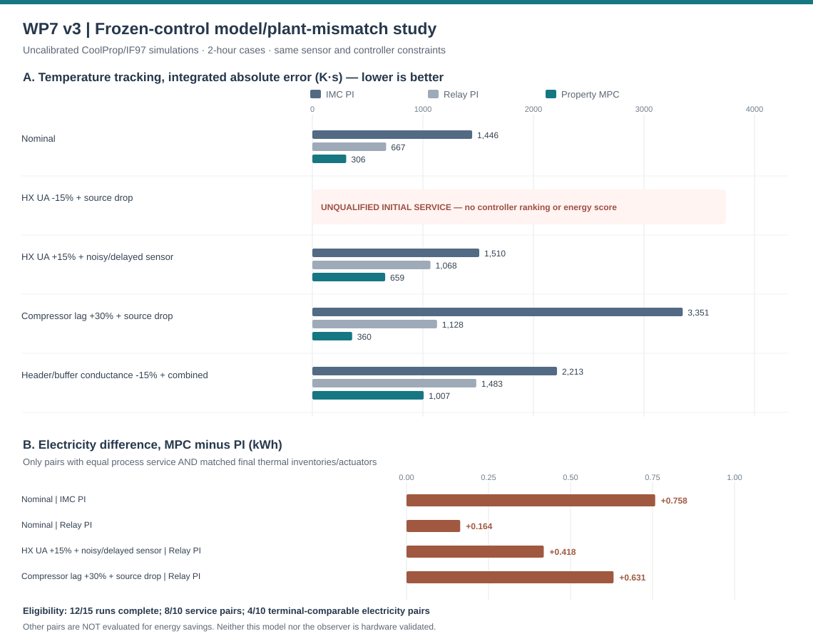

# Research snapshot — dynamic control of industrial high-temperature heat pumps

**Independent computational research prototype · Abhijith Sivaprasadan · November 2026**

**Application context:** doctoral research in advanced control of high-temperature heat pumps for dynamic industrial heat supply. This is a concise *research sample*, not a peer-reviewed article, commercial model, validated digital twin, or laboratory experiment.

Repository: [HTHP-ControlBench](https://github.com/abhijith-sivaprasadan/hthp-controlbench) · [Methods](WP7_PROPERTY_PREDICTOR_V2.md) · [External-evidence audit](WP7_INDEPENDENT_EMPIRICAL_EVIDENCE.md)

## Research question and approach

**When does predictive control genuinely improve the dynamic operation of an industrial HTHP relative to tuned PI control—and when are apparent benefits artifacts of an oversimplified model, incomplete process service or depleted thermal storage?**

I constructed a reproducible research prototype with three linked investigations:

1. **Dynamic plant and feedback control:** a three-state header/buffer/compressor-lag model, finite-flow process heat exchanger, conservation-law integration, two PI identification approaches (FOPDT/IMC and relay-derived), and constrained local-linearization MPC with numerical feasibility checks and PI fallback.
2. **Plantwide and self-optimizing control:** an explicit analysis of available manipulated variables and active process-service constraints, followed by a *separate hypothetical* two-actuator pump/compressor study of economically motivated controlled variables. The one-actuator baseline offers **no nontrivial free economic degree of freedom at the active service boundary**; that negative result matters before proposing SOC.
3. **Thermodynamic and flexibility checks:** a separate R1233zd(E) cycle with CoolProp, IF97 water enthalpy, TESPy equation cross-checks, temperature-qualified buffer storage, and a tariff-scheduled exploratory heuristic. All equipment performance inputs remain assumed.

These models share a scientific scope, but the *synthetic* PI/MPC experiments, two-actuator SOC extension, property-backed controls and tariff examples are **distinct benchmark versions**. Their numerical results must not be pooled as if they came from one calibrated plant.

## Selected reproducible findings

| Study | Evidence produced | Interpretation |
|---|---|---|
| Corrected WP3–WP5, [L1_RelayPeak_v2](../results/L1_RelayPeak_v2/manifest.json) | Versioned tuning and noise/delay/mismatch tests, including explicit active constraints and solver checks | An internally reproducible **synthetic** controller comparison, not empirical equipment performance |
| [WP7 property-consistent MPC v2](../results/wp7_property_predictor_v2_report.md) | 15/15 complete two-hour runs; 10/10 PI–MPC comparisons satisfy simulated service; **5/10** also match terminal inventories and commands | MPC improved tracking relative to the older synthetic predictor in 2/5 scenarios, worsened it in 3/5; among the five eligible PI–MPC electricity pairs, **MPC used more electricity in every pair** |
| [WP7 truth-model mismatch v3](../results/wp7_model_mismatch_v3_report.md) | 15 attempted two-hour runs with fixed nominal control; **12/15 complete** and **4/10** terminal-equivalent energy comparisons | A **15% reduction in process HX UA prevents the fixed 130°C buffer reference from meeting the required starting service** (3 controller runs rejected). Among four eligible pairs, MPC again uses more electricity than the corresponding PI. These are illustrative, not calibrated equipment uncertainties |
| [WP6 SOC/active sets](WP6_SOC_ACTIVE_SET.md) | One-actuator negative freedom result; two-actuator hypothetical active-set, sensitivity and held-out tests | Candidate for experimental work on *when* simple controlled variables approximate economic optimality; **not** proof of industrial optimality |
| [WP8 timestep sensitivity](../results/wp8_timestep_sensitivity_v1.md) | 24 h integration-step screen at 60, 30 and 15 seconds | Modelled tariff saving ≈€0.107/day is small and **not** credible as a real industrial economic benefit |
| [WP7 independent source audit](../results/wp7_external_empirical_evidence_v1.md) | Checksum-verified published R1233zd(E) compressor datasets; generated manufacturer-polynomial records separated from actual measurements | External measurements come from **other compressor designs and operating regimes**; no 310 kW OEM capacity, source/sink, instrumentation or safety validation established |

The central technical lesson is that **tracking, energy consumption, process-service qualification and final stored energy are different quantities**. A controller that tracks a temperature setpoint more closely cannot be declared more efficient if it delivers different useful heat or ends with depleted storage. The comparison therefore rejects missing service, out-of-property-envelope states, partial trajectories, and unmatched header/buffer energy inventories.



*Figure: WP7 v3 property-backed simulation; rejected starting states are marked as unavailable, not plotted as zero. Positive electricity deltas mean MPC consumed more than the corresponding PI comparator. The experiment is not hardware validated.*

## A sensitivity that materially limits the energy claim

The original [WP7 v3 comparator](../results/wp7_model_mismatch_v3_report.md) allows 0.5 kWh thermal mismatch per terminal store (and its total) plus a 0.02 actuator/command difference. An [independent rederivation from the raw controller ledger](../results/wp7_comparability_claim_audit_v4.md) shows **4/10** pairs qualify under that choice; tighter **0.10 kWh thermal** matching leaves **1/10**. The limits are numerical comparability decisions, not sensor uncertainty bounds. Thus the reported positive MPC-minus-PI electricity differences are **conditional and not evidence of an industrial efficiency ranking**. This result is part of the [researcher-facing self-audit](RESEARCHER_RED_TEAM_AUDIT_2026_11_03.md). It is more scientifically informative than hiding rejected pairs.

## Model-transfer challenge and future experimental design

The independently versioned [WP7 v3 model-mismatch experiment](../results/wp7_model_mismatch_v3_report.md) holds nominal PI gains and the property-based MPC predictor frozen while perturbing **only the simulated truth**: process-HX conductance, header-to-buffer conductance or compressor response lag. It also tests sensor noise/delay and source/return disturbances. Its nominal anchor must reproduce WP7 v2 within audited numerical tolerances. An infeasible starting service point is reported as **not comparable**, never silently dropped or retuned.

This is still a *model-plant mismatch sensitivity* study, not a statistically calibrated uncertainty distribution. The next doctoral-grade validation steps require:

- **Instrumented pilot data:** named compressor and HTHP installation, OEM displacement/efficiency and safe-pressure envelope, finite source/sink flows, heat-exchanger maps and calibrated electrical/temperature/flow sensors.
- **Independent parameter identification:** excitation and fitted operating maps on a training interval, then strictly future, held-out dynamic sequences with no header/modulation truth leaked into the observer.
- **Robust control comparison:** predeclared disturbance and model-uncertainty sets, same usable sensor/actuator budget, solver failure and safety fallback logging, physically matched terminal energy, and service-qualified performance.
- **Advanced control extension:** first test constraint-aware MPC and genuine SOC degrees of freedom on a measured pilot; assess learning-based control only with a separate safety supervisor and validated off-policy/experimental protocol.

The code already contains a [measured-observer seven-channel acquisition contract](WP7_INSTRUMENTED_OBSERVER_DATA_CONTRACT.md) and a hash-verified *local* held-out scoring interface. **No corresponding instrumented dataset has been provided**, so experimental observer accuracy remains unknown.

## Verification and reproduction

The repository includes numerical/unit tests for conservation, heat-exchanger limiting behaviour, property-envelope rejection, actuator slew, sensor parity, split-data checks and objective/terminal-equivalence gates. Corrected benchmark results remain separately versioned instead of overwriting older outputs.

```bash
python -m pip install -e '.[realfluid,qp]'
python -m unittest discover -s tests -v
python scripts/run_wp7_property_predictor.py
python scripts/run_wp7_model_mismatch.py
```

**Evidence boundary:** The reference assumes a 310 kW condenser duty and derives an *equivalent* compressor displacement from that duty; it is **not a manufacturer rating**. The properties are physical calculations, but the device configuration, thermal capacities, efficiencies, hydraulic conditions and control design are research assumptions. The external test datasets have not validated this target machine. Conclusions concern numerical methodology and limitations, not safe or economical operation of industrial equipment.

*Proposed research direction: combine verifiable thermodynamic models, rigorous service-aware control benchmarks, active-set/SOC analysis and lab measurements to develop credible, experimentally evaluated HTHP control strategies.*
